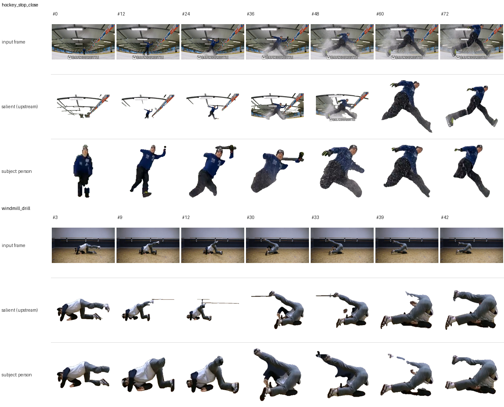
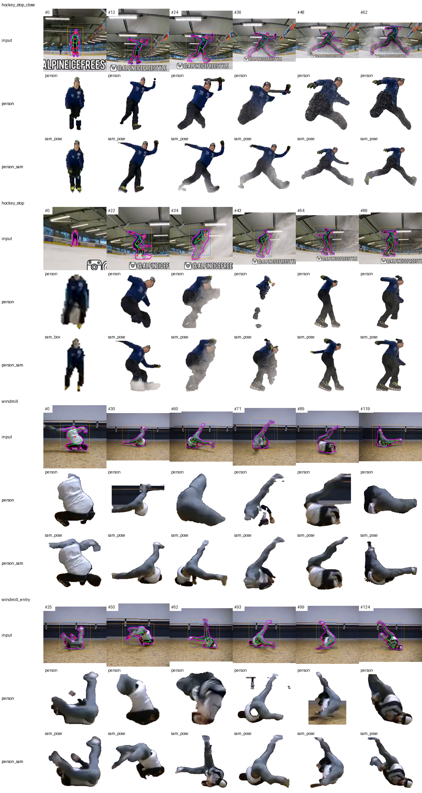
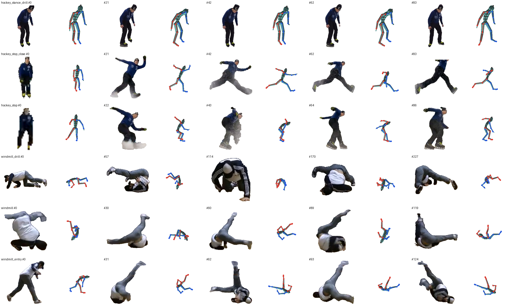

# mocap-yt-test

Motion capture from YouTube videos with [MocapAnything V2](https://github.com/phongdaot/MocapAnything)
(`video2pose2rot`), running **CPU-only**, onto a generated Mixamo-convention humanoid rig.
The output is BVH plus animated glTF.

```
YouTube URL / local file / hf:// ──► clip (start–end, 15 fps, 720p) ──► frames
     ──► matte one person on white + square crop, by `subject`:
           salient     RMBG-1.4 on the whole frame (upstream)
           person      person detector + tracker → RMBG ∩ person mask on a region around them
           person_sam  same tracker → ViTPose keypoints → SAM 2.1 prompted with them
     ──► DINOv2-large tokens (cached)
     ──► MocapAnything video2pose2rot  (conditioned on the Humanoid rig's reference frame)
     ──► joint positions + 6D rotations ──► BVH ──► glTF (skinned mannequin + bones)
                                                └─► preview mp4 / screenshots
```

## Quick start

```bash
git submodule update --init           # third_party/MocapAnything (pinned)
uv sync                               # CPU-only torch from download.pytorch.org/whl/cpu
uv run mocap-yt setup                 # weights: MocapAnything ckpt, RMBG-1.4, DINOv2-large, T5-base, person detector/segmenter, ViTPose, SAM 2.1
uv run mocap-yt rig                   # generate the humanoid + its MocapAnything dataset
uv run mocap-yt run --publish         # every sample in configs/samples.yaml
uv run mocap-yt run demo_trap --publish   # ...or selected ids
scripts/gltf_screenshots.sh           # three.js screenshots of the published GLBs
uv run --group dev pytest             # tests
```

To add a video, add an entry to [`configs/samples.yaml`](configs/samples.yaml) with an `id`,
a `source` (a URL, a path relative to the repo root, or `hf://…`), and optionally `start` +
`end` (or `duration`), `height`, `crop`, `subject` (`salient`, `person` or `person_sam`, see
[below](#in-the-wild-footage-subject-person)) and `cookies`. Times are seconds or
`"[[HH:]MM:]SS[.fff]"` strings such as `"3:33.5"`. Every stage writes into `work/` (gitignored)
and is skipped if its output already exists. Changing a sample's range, `fps`, `height` or `crop`
rebuilds its clip and features; changing `subject` (or a `person_sam:` setting, for those samples)
recomputes its features. `--publish` copies
the lightweight results into `assets/samples/<id>/`.

### Picking and trimming time ranges

Long videos (tutorials, compilations) need a time range per sample: one continuous shot with
the whole body in view, and no cut, cross-fade or title card inside it.

```bash
uv run mocap-yt sheet video.mp4 --every 3                 # timestamped contact sheets -> work/sheets/
uv run mocap-yt sheet video.mp4 --start 5:00 --end 5:40 --every 0.5   # zoom in on a candidate
uv run mocap-yt trim video.mp4 3:33.5-3:39.3 4:17+15      # cut ranges out -> work/clips/
uv run mocap-yt trim --samples --audio                    # each configured local sample's range -> work/clips/<id>.mp4
uv run mocap-yt fetch hockey_stop                         # trim + extract frames for a configured sample
```

`trim` re-encodes, so cuts are frame-accurate, and keeps the source frame rate and size unless
`--fps`/`--height` are given (`--audio` keeps the sound). The pipeline itself doesn't need
pre-trimmed files: it cuts each sample's `start`–`end` out of the source.

### YouTube access

`mocap-yt` downloads with `yt-dlp`. YouTube asks datacenter IPs (cloud VMs, CI) to
"sign in to confirm you're not a bot". If you hit that, either:

* export your browser's YouTube cookies to a Netscape `cookies.txt` and set
  `cookies: path/to/cookies.txt` on the sample, or
* download the video yourself and point `source:` at the local file.

## Layout

| Path | What |
|---|---|
| `src/mocap_yt/skeleton.py` | `Skeleton`, forward kinematics, procedural **Mixamo-convention humanoid** (`mixamo_humanoid`) |
| `src/mocap_yt/mesh.py` | capsule mannequin skin + linear blend skinning |
| `src/mocap_yt/bvh.py` | BVH writer/reader (Mixamo-style channels: `Z Y X`, `End Site` leaves) |
| `src/mocap_yt/gltf.py` | glTF 2.0 export (joint node tree, skin, meshes, animation); `.glb` or `.gltf` |
| `src/mocap_yt/render.py` | CPU z-buffer rasterizer + skeleton overlays (no OpenGL/Blender needed) |
| `src/mocap_yt/rig_assets.py` | builds the MocapAnything **"species" dataset** for a rig without Blender (see below) |
| `src/mocap_yt/features.py` | CPU port of upstream's RMBG + crop + DINOv2 preprocessing (upstream's version hard-codes CUDA), plus person-guided matting for in-the-wild footage |
| `src/mocap_yt/person_sam.py` | pose-prompted SAM matting (`subject: person_sam`): ViTPose with rotation test-time augmentation, prompts from keypoints, SAM 2.1, mask clean-up and checks |
| `src/mocap_yt/inference.py` | loads the released checkpoint, runs `video2pose2rot`, sliding windows for clips longer than 300 frames, BVH export |
| `src/mocap_yt/video.py` | yt-dlp download, timestamp parsing, ffmpeg trim/resample, timestamped contact sheets, frame extraction |
| `src/mocap_yt/pipeline.py`, `cli.py` | config-driven orchestration (`mocap-yt …`), including `mocap-yt matte` to compare matting modes on a few frames |
| `scripts/gltf_screenshots.sh` | renders published GLBs in three.js (headless Chromium via Playwright); all of them, or the ones given as arguments |
| `third_party/MocapAnything` | upstream, git submodule pinned at `c99fb22` |
| `assets/rigs/humanoid/` | the generated rig: BVH, glTF/GLB, previews, reference render |
| `assets/samples/<id>/` | per-video results: `.glb`, `.bvh`, preview `.mp4`, screenshots, `prediction.json` |

## The humanoid rig

I didn't find a free, redistributable humanoid that suits this model. Mixamo needs an Adobe
login and its assets can't be redistributed. The CC-BY Khronos samples (`RiggedFigure`,
`CesiumMan`) have 19 joints named like `leg_joint_L_1`, with no head or toe end joints.
MocapAnything embeds every joint **name** with T5. Its `obj1k` training split is mostly
Mixamo-style humanoids. So the rig is **generated** by `mixamo_humanoid()`:

* the 25-joint Mixamo "no fingers" hierarchy (`Hips, Spine, Spine1, Spine2, Neck, Head,
  HeadTop_End, {Left,Right}{Shoulder,Arm,ForeArm,Hand,UpLeg,Leg,Foot,ToeBase,Toe_End}`).
  `fingers: true` adds the 4-segment finger chains;
* anthropometric proportions (fractions of stature, 1.75 m by default), T-pose rest,
  Y-up, facing +Z, meters;
* a capsule "wooden mannequin" skin, rigidly weighted, that is rendered for the
  reference image and used in the glTF.

Files in `assets/rigs/humanoid/`: `humanoid_tpose.bvh`, `humanoid_skeleton.gltf` (bones only),
`humanoid_rigged.glb` (mannequin + bones, skinned), `humanoid_calibration.{bvh,glb}`,
`preview_*.png`, `reference_render.png` / `reference_model_input.png` (what DINOv2 sees),
`rig.json`.

### Rig → MocapAnything dataset (Blender-free)

Upstream builds per-rig data from an FBX with Blender (`preprocess/run_pipeline.sh`).
`rig_assets.build_rig_dataset` writes the same files directly from the procedural rig
into `work/rigs/<Rig>/`:

| file | how |
|---|---|
| `bvh/<Rig>#calib/y{0,90,180,270}.bvh` | a 2 s calibration clip: frame 0 is the reference pose (A-pose by default), then every non-end joint moves a little so static-joint detection matches real data |
| `bvh_pose/…/y*.npz` | upstream's own `utils.bvh` + `utils.animation` (same math as `extract_bvh_pose.py`) |
| `species_info_dict.npy` | upstream's `preprocess/build_species_info.build` (topology, T5 name embeddings, static joints) |
| `cache/__mesh2pose1002_species_scale_cache.pkl` | same definition as `build_scale_cache.py` |
| `npz_train_image_only/…/y0.npz` | DINOv2 tokens of the rendered reference frame |
| `characters/<Rig>/<Rig>_ffs.bvh` | rest-pose template used to write predicted rotations to BVH |

## In-the-wild footage: `subject: person`

Upstream's preprocessing mattes the most salient object in the frame and crops to the
largest foreground region. That is enough for its human demo clips, a person on a plain
background, but not for real videos. On the hockey tutorial's wide-angle rink shots, while
the skater is still far away, RMBG-1.4 mattes the **ceiling rafters**, so DINOv2 is fed a crop
of the ceiling. In the dance studio the dancer's mask swallows the ballet barre or a dark wall
panel touching their foot.

`subject: person` (per sample, in `configs/samples.yaml`) keeps the model's input format, one
person matted on white in a square crop, but chooses *who* is matted:

1. a person detector (torchvision Faster R-CNN, MobileNetV3-FPN, COCO) runs on every frame;
2. one person is tracked through the clip: the track is anchored on the most confident large
   detection, linked frame to frame by box overlap, and gaps are interpolated;
3. RMBG runs on a square region twice the size of that person's box. Its mask is intersected
   with a semantic person mask (torchvision DeepLabV3-MobileNetV3, COCO/VOC classes, dilated,
   then closed to bridge gaps inside unusual poses), so walls, bars and beams touching the
   person drop out. When the segmenter misses most of the person, as it does for some
   upside-down windmill poses, that frame keeps RMBG's mask instead of being dropped. The mask
   is then opened to drop thin bars, clipped to the box plus 15%, and reduced to the
   components that lie inside the box.

This costs about 0.8 s/frame on 4 vCPUs on top of RMBG's ~2 s/frame. The default,
`subject: salient`, is upstream's preprocessing unchanged; the rig's reference image is always
processed that way. The preview's "model input" tile shows the crop DINOv2 actually saw.



### Pose-prompted SAM: `subject: person_sam`

`subject: person` still loses the person wherever both RMBG and the person segmenter do: an
arm or leg that is motion-blurred at 15 fps, grey clothes against the grey studio wall, a body
upside down. The mask then drops limbs, falls apart into blobs, or keeps a piece of wall bar.
`subject: person_sam` keeps the same tracker but builds the mask from the person's 2D pose
([`person_sam.py`](src/mocap_yt/person_sam.py)):

1. **Pose.** ViTPose-B (COCO-17 keypoints, top-down on the tracked box) runs on the frame
   turned by 0, 90, 180 and 270° in one batch. The turn with the best mean keypoint score is
   kept (it must beat upright by 0.05) and its keypoints are mapped back. COCO has hardly any
   upside-down people. ViTPose is about as sure of a sideways person as of an upright one,
   but not of an upside-down one, so on a windmill this picks a view it can read.
2. **Prompt.** Up to 8 positive points inside the body:
   * the torso centre and the head;
   * a point on each forearm and shin: the wrist or ankle moved 20 % toward the elbow or knee,
     because a point on the very tip of a limb sits on its outline and pulls background in;
   * the knees.

   The box prompt is the tracked box grown to hold every confident keypoint. With fewer than
   3 points, or a person under 40 px, the prompt is the box alone.
3. **SAM 2.1** (Hiera-S) runs on a square region twice the person's size (at least 160 px), so
   a distant skater is enlarged. The region is encoded once; the decoder tries the points and
   box, then the box alone.
4. **Clean-up.**
   * Small holes are filled.
   * Thin bars are opened away, except along the stick figure, so thin blurred forearms stay.
   * The mask is clipped to the box plus 25 %, and only the parts that hold a keypoint or a
     prompt point are kept.
5. **Check.** A mask is used when:
   * SAM reports an object;
   * its own IoU estimate is ≥ 0.5;
   * it holds ≥ 75 % of the prompt points;
   * it fills 8–90 % of the box.

   Otherwise that frame is matted as with `subject: person`. `prediction.json` counts how many
   frames got each kind of mask (`person_sam.mask_source`).

**Cost on 4 vCPUs.** Pose takes 0.5 s/frame (the four turns in one batch) and SAM 1.5 s/frame.
RMBG and the person segmenter, about 2.5 s/frame, only run on fallback frames. The six tutorial
clips take 39 min with `person_sam` instead of 52 min with `person`.

**On the tutorial clips:**
* On 41 frames picked across the six clips and checked by eye, including every bad frame
  mentioned [below](#tutorial-videos-in-assetssamples), the `person` crop loses a limb, falls
  apart, or keeps a bar, beam or floor patch in 21. None of the `person_sam` crops do.
* Both modes keep ice spray where it touches the skates.
* Of the 644 frames of the five clips that now use `person_sam`:
  * 634 got a points + box mask;
  * 10 got a box-only mask (a distant skater, or a pose too unsure);
  * none fell back to RMBG.

The checkpoints and the pose rotations are set in the `person_sam:` block of
`configs/samples.yaml`. The other knobs are fields of `PersonSamConfig`. Changing any of them
recomputes the features of the `person_sam` samples, and the cached poses (`poses.npz`) are
kept unless a pose setting changed.

To compare matting modes on a few frames without running the capture:

```bash
uv run mocap-yt matte windmill:0,30,60,71,89,119 hockey_stop:0,43 --modes person person_sam
```

This writes `work/matte/<ids>.png` and a `.json` with each frame's chosen rotation and SAM
statistics. The PNG shows the input around the person with overlays (blue: tracked box; green:
pose; red: prompt points; orange: prompt box; magenta: SAM mask), then each mode's crop.



## Results so far

| sample | source | frames | status |
|---|---|---|---|
| `yt_nIfU38nAYYk` | https://youtu.be/nIfU38nAYYk | – | **not downloaded**: YouTube refused this cloud VM (bot check, then HTTP 403 on the media). Needs `cookies:` or a local file, see above |
| `demo_trap` | MocapAnything demo clip `inputs/nbg_human/trap.mp4` | 300 @ 15 fps | ✅ `assets/samples/demo_trap/` |
| `demo_gt` | MocapAnything demo clip `inputs/nbg_human/gt.mp4` | 300 @ 15 fps | ✅ `assets/samples/demo_gt/` |
| `hockey_stance_drill` | hockey tutorial 2:41.8–2:47.4 | 84 @ 15 fps | ✅ `assets/samples/hockey_stance_drill/` |
| `hockey_stop_close` | hockey tutorial 3:26.6–3:32.2 | 84 @ 15 fps | ✅ `assets/samples/hockey_stop_close/` |
| `hockey_stop` | hockey tutorial 3:33.5–3:39.3 | 87 @ 15 fps | ✅ `assets/samples/hockey_stop/` |
| `windmill_drill` | windmill tutorial 4:17.0–4:32.2 | 228 @ 15 fps | ✅ `assets/samples/windmill_drill/` |
| `windmill` | windmill tutorial 5:17.6–5:25.6 | 120 @ 15 fps | ✅ `assets/samples/windmill/` |
| `windmill_entry` | windmill tutorial 5:26.7–5:35.0 | 125 @ 15 fps | ✅ `assets/samples/windmill_entry/` |

### Tutorial videos in `assets/samples/`

Two 360p YouTube tutorials are checked in: *Hockey Stop in 3 Minutes – Learn to Stop on Ice*
(220 s, 24 fps) and *How to Windmill – Full Breakdancing Tutorial for Beginners* (337 s,
29.97 fps). Neither is usable whole. Both mix talking-head shots, close-ups of
skates, title cards, a subscribe overlay and cuts (hockey) or cross-fades (windmill, which scene
detection doesn't catch); the windmill studio also has a wall mirror. The six ranges above were
picked with `mocap-yt sheet` at 3 s, then 0.5 s, then 0.1 s around each boundary. Each is one
continuous shot with the whole body in view, the windmill ones from the camera angle without
the mirror. All six run at the source's 360p (`height: 360`). Five use `subject: person_sam`.
The stance drill, which `person` already mattes cleanly, keeps `subject: person`: both modes
give the same crops there (5.5 cm with `person_sam`).

```bash
uv run mocap-yt run hockey_stance_drill hockey_stop_close hockey_stop windmill_drill windmill windmill_entry --publish
scripts/gltf_screenshots.sh assets/samples/{hockey,windmill}*/*.glb
uv run mocap-yt gallery hockey_stance_drill hockey_stop_close hockey_stop windmill_drill windmill windmill_entry -o assets/samples/yt_tutorials_gallery.png
```

That takes about 40 min on 4 vCPUs (52 min when all six used `subject: person`), nearly all of
it pose and SAM, or RMBG. Model input next to the capture, 5 frames per clip:



| sample | FK vs. pred | what the capture shows |
|---|---|---|
| `hockey_stance_drill` | 5.4 cm | The hip-turn drill in place, facing the camera. The knee bend, forward lean, lowered head and hanging arms are all there. |
| `hockey_stop_close` | 12.7 cm (13.4 person, 17.2 salient) | The skater comes in from about 25 px tall and stops right at a low fisheye camera. The wide-legged stop stance is captured, now with both arms out; the matte no longer picks up a ceiling beam. The far-away start and the spray are rough. |
| `hockey_stop` | 12.2 cm (14.7 person, 17.9 salient) | Approach, stop in a cloud of ice spray, sideways knees-bent stance. Right before and after the stop. At the stop itself the spray hides the legs: the matte no longer falls apart there, but it keeps the spray around the skates. |
| `windmill_drill` | 24.3 cm (23.6 person) | Floor drill: all fours, folded, legs up. The gross configuration is right (on the floor, inverted with legs up); limb placement is unreliable. |
| `windmill` | 31.0 cm (31.3 person) | Continuous windmills: the upside-down, legs-up V is there, with heavy motion blur at 360p. The matte now holds the whole dancer on every frame. With `person`, frames the segmenter missed lost the blurred limbs or carried a piece of the wall bar or floor. |
| `windmill_entry` | 24.5 cm (26.7 person) | The standing lunge into the move is captured well, then as `windmill`. |

The FK-vs-pred column is the consistency metric below; "person" and "salient" are the same clip
run with those subjects. It is no accuracy measure, since there is no ground truth, but it tracks
how unsure the model is: a stance drill gets better agreement than the demo clips, while
upside-down floor moves, far from the Mixamo-style motions the model was trained on, get the
worst. Cleaner crops move it a little on the hockey clips and hardly at all on the floor moves:
there the model's unfamiliarity with the motion dominates. The model predicts no global
trajectory, so the captured skaters don't travel across the rink.

Each `assets/samples/<id>/` holds:

* `<id>_humanoid.glb`: the skinned mannequin + bones with the captured animation;
* `<id>_humanoid.bvh`;
* `<id>_preview.mp4` and `<id>_preview_strip.png`: input | model input (the matted crop
  DINOv2 sees; samples run before this tile existed don't have it) | capture front | capture side;
* `<id>_input_contact_sheet.png`: 8 input frames;
* `<id>_humanoid_threejs.png`: the GLB played back in three.js, an independent viewer check
  produced by `scripts/gltf_screenshots.sh`;
* `prediction.json`: timings and a consistency metric.

`fk_vs_pred_position_err_m` in `prediction.json` is the mean distance between the
model's predicted joint positions and forward kinematics of its predicted rotations,
around 8–10 cm on the demo clips. The model's two heads agree only approximately.
`prediction.json` also records the sample's range (`start`/`end`, seconds) and `subject`.

## Notes and limitations

* **No global trajectory.** The model predicts root-relative pose. The exporter keeps the
  lowest joint on the floor (`ground_motion`), and the root doesn't translate horizontally.
* Upstream caps one forward pass at 301 frames. Longer clips run in 300-frame windows with
  32-frame linear cross-fades.
* Upstream pads every skeleton to 150 joints. No weight depends on that size, so padding only
  to the rig's 25 joints gives the same output (`tests/test_inference.py`, to 1e-4) and cuts the
  forward pass for 300 frames from about 107 s to about 16 s on 4 vCPUs.
* CPU cost is dominated by preprocessing: RMBG-1.4 matting at 1024² plus DINOv2-large takes
  about 10 min per 300 frames on 4 vCPUs. The result is cached in `work/samples/<id>/features.npz`.
  `subject: person_sam` replaces RMBG with ViTPose (0.5 s/frame) and SAM 2.1 (1.5 s/frame); its
  poses are cached in `poses.npz` next to it.
* Model licence: MocapAnything code and weights are MIT. RMBG-1.4 (BRIA AI) has its own,
  non-commercial terms. The person detector/segmenter are torchvision's COCO-trained weights
  (BSD-3 code; COCO annotations are CC BY 4.0). SAM 2.1 (`facebook/sam2.1-hiera-*`) and ViTPose
  (`usyd-community/vitpose-base-simple`) are Apache-2.0.
